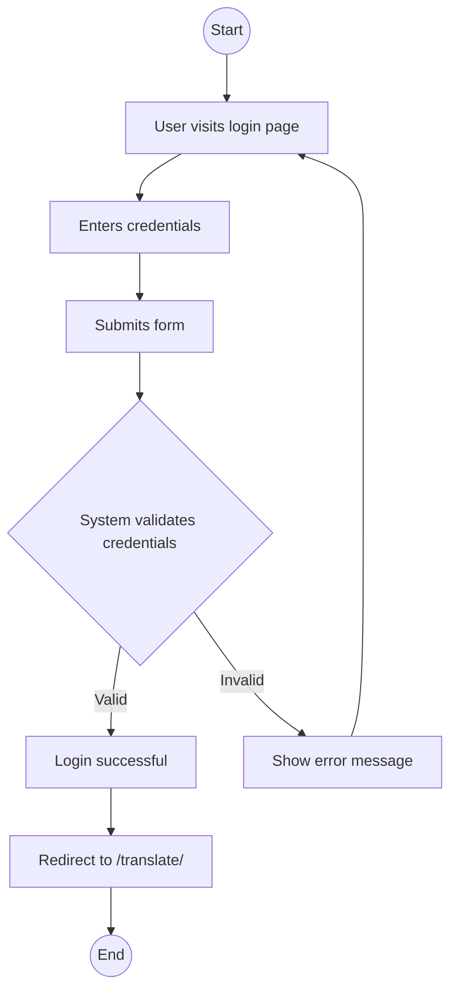
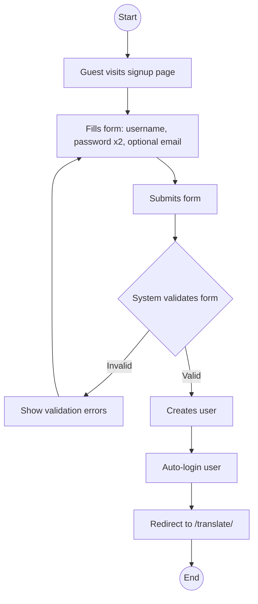
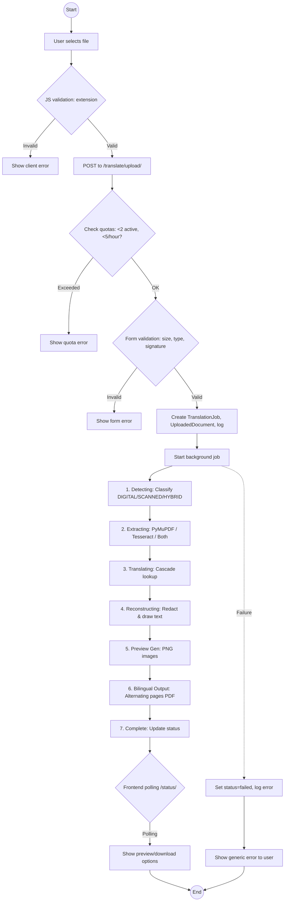
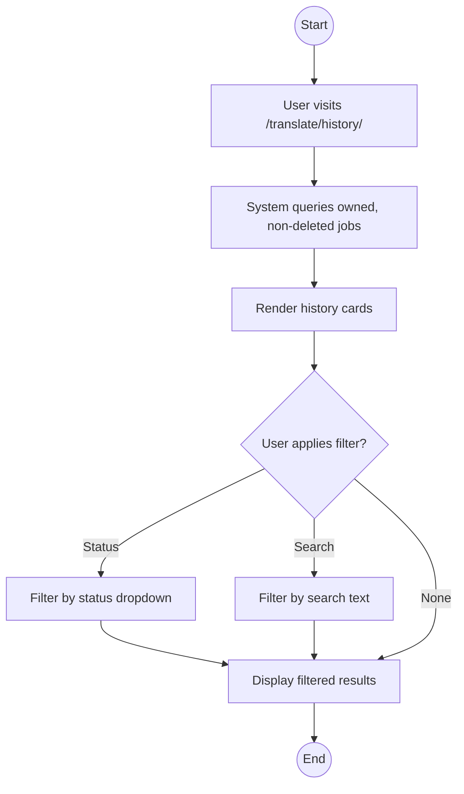
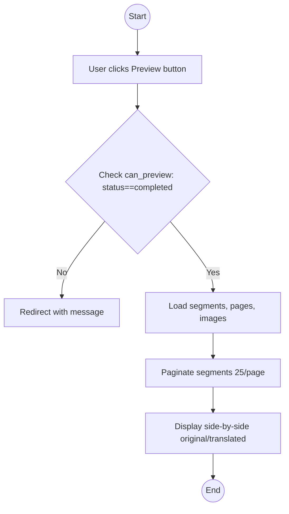
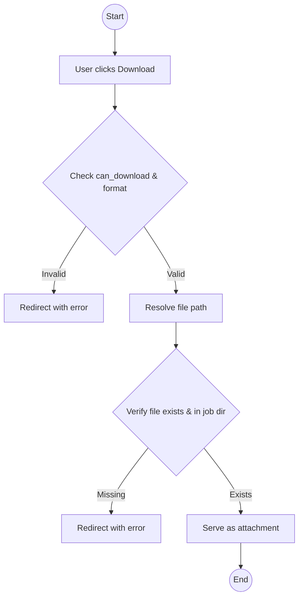
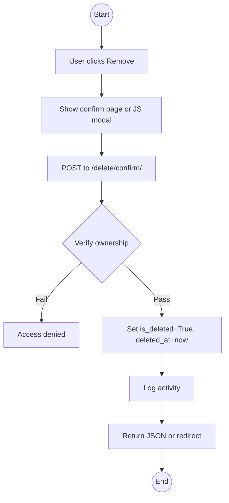
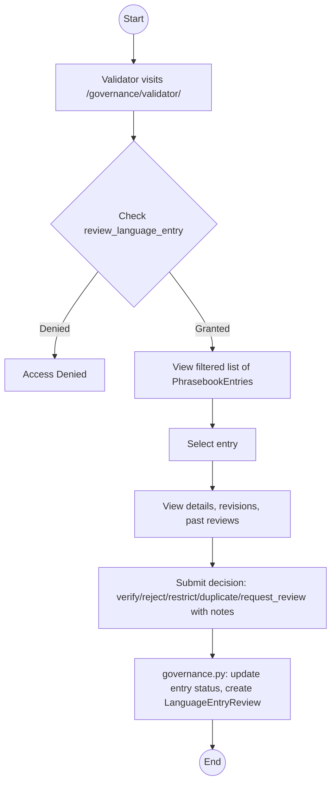
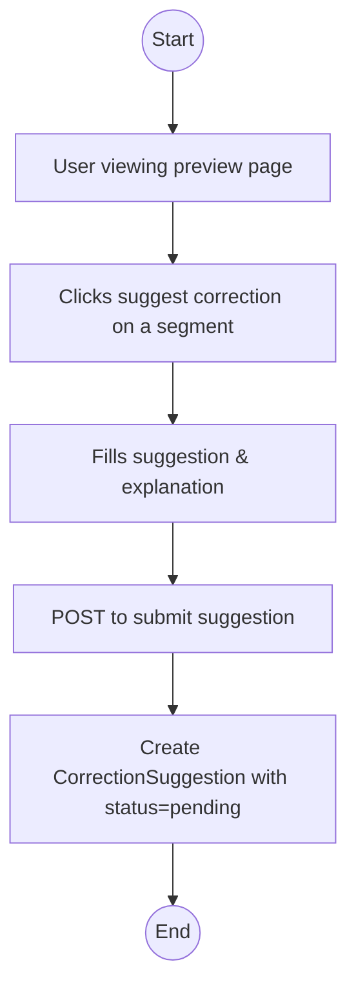
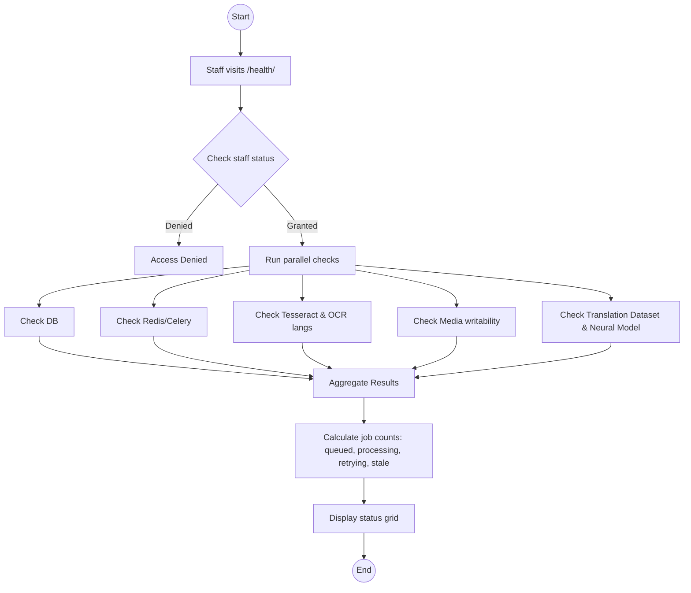

# Activity Diagrams

This document contains activity diagrams for the major workflows within the LingoKatutubo system.

## AD-01: User Authentication (Login)

*   **Actors:** User, System
*   **Preconditions:** User has an existing account.
*   **Trigger:** User navigates to the login page.
*   **Main Process:** User inputs username and password -> System validates against DB -> Upon success, session is created and user is redirected to the main application.
*   **Error Paths:** Incorrect username or password results in an error message, prompting the user to try again.
*   **Final Output:** Authenticated session, redirection to `/translate/`.
*   **Evidence:** `views.py:166-179` (TranslatorLoginView), `registration/login.html`

## AD-02: User Registration

*   **Actors:** Guest, System
*   **Preconditions:** None.
*   **Trigger:** Guest navigates to the registration page.
*   **Main Process:** Guest provides required details -> System applies Django password validators and uniqueness checks -> System creates the user -> Auto-logs in the user -> Redirects to main app.
*   **Error Paths:** Weak passwords or existing usernames trigger form errors, returning the user to the form.
*   **Final Output:** New user record, authenticated session, redirection to `/translate/`.
*   **Evidence:** `views.py:154-163`, `forms.py:119-124`

## AD-03: Document Upload and Translation Pipeline

*   **Actors:** User, System, Background Worker (Thread/Celery)
*   **Preconditions:** User is authenticated.
*   **Trigger:** User selects a file and clicks upload.
*   **Main Process:** 
    1. Client and server validation of the uploaded file.
    2. Quota verification.
    3. Job initialization and database record creation.
    4. Execution of the background pipeline (Detect -> Extract -> Translate -> Reconstruct -> Preview -> Output).
    5. Frontend polling for completion.
*   **Error Paths:** File validation failures, quota exceedance, or pipeline processing errors. Pipeline errors show generic messages to users but log technical details for staff.
*   **Final Output:** Completed translation job, preview images, output PDF.
*   **Evidence:** `views.py:430-546`, `pipeline_service.py`, `reconstruction_service.py`

## AD-04: Translation History Management

*   **Actors:** User, System
*   **Preconditions:** User is authenticated and has previously uploaded documents.
*   **Trigger:** User navigates to the history page.
*   **Main Process:** System retrieves active jobs for the user -> Applies any selected status or text filters -> Displays the results.
*   **Error Paths:** None (empty results are displayed normally).
*   **Final Output:** Filtered list of translation jobs.
*   **Evidence:** `views.py:251-299`

## AD-05: Bilingual Preview

*   **Actors:** User, System
*   **Preconditions:** Job status is 'completed'.
*   **Trigger:** User requests to preview a specific translation job.
*   **Main Process:** System verifies job status -> Loads translation segments and preview images -> Paginates segments -> Renders side-by-side comparison.
*   **Error Paths:** Requesting preview for a non-completed or non-existent job results in a redirect or error.
*   **Final Output:** Bilingual preview interface.
*   **Evidence:** `views.py:344-427`, `preview.html`

## AD-06: Download Translated PDF

*   **Actors:** User, System
*   **Preconditions:** Job status is 'completed'.
*   **Trigger:** User requests to download the translated or bilingual PDF.
*   **Main Process:** System verifies permissions and job status -> Resolves file path safely -> Serves the file as a download attachment.
*   **Error Paths:** Invalid access, missing file, or path traversal attempts result in errors/redirects.
*   **Final Output:** Downloaded PDF file.
*   **Evidence:** `views.py:685-719`

## AD-07: Job Deletion (Soft Delete)

*   **Actors:** User, System
*   **Preconditions:** User owns the job.
*   **Trigger:** User confirms deletion of a job.
*   **Main Process:** System verifies ownership -> Performs soft deletion (flags record instead of removing data) -> Logs the action -> Returns success response.
*   **Error Paths:** Attempting to delete another user's job fails ownership check.
*   **Final Output:** Soft-deleted job record.
*   **Evidence:** `views.py:808-868`

## AD-08: Validator Review

*   **Actors:** Validator, System
*   **Preconditions:** User has appropriate validator permissions.
*   **Trigger:** Validator selects a dictionary entry for review.
*   **Main Process:** Validator views entry details and history -> Submits a review decision -> System updates entry status and logs the review.
*   **Error Paths:** Insufficient permissions block access.
*   **Final Output:** Updated entry status, new review record.
*   **Evidence:** `views.py:759-788`, `governance.py:50-84`

## AD-09: Correction Suggestion

*   **Actors:** User, System
*   **Preconditions:** User is viewing a translation preview.
*   **Trigger:** User submits a correction for a specific segment.
*   **Main Process:** System receives the suggested text and explanation -> Creates a pending correction record for review.
*   **Error Paths:** Invalid segment ID or empty input.
*   **Final Output:** Pending `CorrectionSuggestion` record.
*   **Evidence:** `views.py:791-805`

## AD-10: System Health Check (Staff)

*   **Actors:** Staff, System
*   **Preconditions:** User is authenticated as staff.
*   **Trigger:** Staff member navigates to the health dashboard.
*   **Main Process:** System verifies permissions -> Executes multiple subsystem checks (database, cache, OCR engines, filesystem, models) -> Aggregates operational statistics -> Renders comprehensive health dashboard.
*   **Error Paths:** Insufficient permissions block access.
*   **Final Output:** System health dashboard.
*   **Evidence:** `views.py:747-756`, `871-1058`
