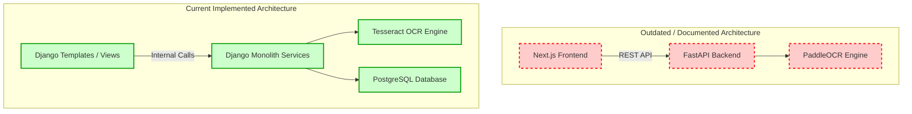

# System Audit: Findings and Recommendations

This document outlines the findings and recommendations from the system audit of the LINGOKATUTUBO application. The findings have been classified by severity and categorized into specific operational and architectural areas.

## 1. Confirmed Issues

The following table details the concrete issues identified during the code audit (F-001 through F-010), classified by severity.

| ID | Severity | Finding | Area | Description | Impact | Recommendation |
|----|----------|---------|------|-------------|--------|----------------|
| **F-001** | High | Quick Translate API lacks authentication | Authorization | The `quick_translate` view at `/api/quick-translate/` has no `@login_required` or any authentication decorator. | Unauthenticated access to translation service, potential abuse/rate-limiting concern. | Add `@login_required` or document as intentionally public and add rate limiting. |
| **F-004** | Medium | Correction suggestion lacks reviewer UI | Feature Gap | Users can submit CorrectionSuggestions via the preview page, but there is no workflow for administrators to review, accept, or reject these. | Submitted corrections are never acted upon through the web interface. | Create a reviewer queue for CorrectionSuggestions. |
| **F-005** | Medium | `GlossaryTerm` model unused in pipeline | Dead Code | `GlossaryTerm` model exists but is never queried. Translation uses `PhrasebookEntry` and `translation_data.json` instead. | Unused database entity, potential developer confusion. | Integrate `GlossaryTerm` into the pipeline or deprecate/remove the model. |
| **F-006** | Medium | `approve_runtime_entry` permission gap | Authorization | Custom permission `approve_runtime_entry` is defined but not assigned to any group or checked in any view. | Dead permission that cannot be used. | Assign to appropriate group or remove. |
| **F-007** | Medium | `Language` models not used in translation | Architecture | `TranslationJob` uses string fields (`source_language`, `target_language`) instead of FK references to the existing `Language` model. | Data integrity not enforced at the database level for language specification. | Migrate to FK references or document as intentional design. |
| **F-008** | Medium | `DatasetImportBatch` has no workflow | Feature Gap | Model exists with status fields but no view, management command, or service processes it. | Confusing duplicate import tracking model. | Clarify purpose or deprecate in favor of `LanguageResourceImportBatch`. |
| **F-009** | Medium | Abandoned Next.js frontend directory | Code Hygiene | `frontend/` directory contains `.next/`, `node_modules/`, and Next.js scaffolding. | Repository clutter and potential confusion. | Remove the abandoned `frontend/` directory. |
| **F-010** | Medium | No brute-force login protection | Security | Login form uses standard `AuthenticationForm` with no rate limiting or lockout mechanism. | Potential for brute-force attacks on user accounts. | Add `django-axes` or similar rate limiting. |

## 2. Potential Risks

These findings represent architectural, UX, or feature risks that may cause operational issues in production.

| ID | Severity | Risk | Description | Mitigation Strategy |
|----|----------|------|-------------|---------------------|
| **F-010** | Medium | **Account Takeover Risk** | Lack of brute-force login protection leaves accounts vulnerable to credential stuffing. | Implement robust rate-limiting (e.g., `django-axes`) and CAPTCHA mechanisms on authentication endpoints. |
| **F-013** | Low | **Experimental Neural Translation** | ByT5 neural fallback is disabled by default, and all neural outputs are flagged as `needs_review`. | Clearly document status, provide validation tooling, and continuously benchmark neural vs. phrasebook accuracy. |
| **F-011** | Low | **Account Lockout UX** | `SignUpForm` makes email optional, but password reset requires it. Users skipping email cannot recover accounts. | Make email a required field during registration or show a clear warning to users. |
| **F-012** | Low | **Dev-Only Email Configuration** | Password reset emails route to the console in development without clear production SMTP documentation. | Document SMTP setup requirements clearly in `README.md` or `.env.example`. |

## 3. Documentation Gaps

Discrepancies between system documentation and actual implementation.

| ID | Severity | Gap | Description | Action Required |
|----|----------|-----|-------------|-----------------|
| **F-002** | High | **Outdated Architecture Docs** | `ARCHITECTURE_DIAGRAM.md` describes a FastAPI + Next.js stack, but the codebase is a Django monolith. | Rewrite `ARCHITECTURE_DIAGRAM.md` to reflect the current Django architecture. |
| **F-003** | High | **False OCR Claims** | PaddleOCR is documented as the OCR engine, but only Tesseract is implemented (`ocr_service.py`). | Remove PaddleOCR references or mark them as "planned/not-implemented." |

## 4. Diagram Gaps

The existing documentation diagrams fail to capture the reality of the system's architecture. The comparison below illustrates the gap between what is documented versus the actual system state.

## 5. Test Coverage Gaps

Based on the audit findings, several key areas require expanded automated or manual test coverage:
*   **Correction Suggestions (`F-004`)**: The full lifecycle from user submission to admin validation/rejection is untested because the admin UI is missing.
*   **Password Reset Flow (`F-011`, `F-012`)**: Tests must cover edge cases where users attempt resets without emails, and integration tests should verify real SMTP dispatch capabilities.
*   **Authentication & Rate Limiting (`F-001`, `F-010`)**: Missing tests verifying that `/api/quick-translate/` handles load safely and that brute-force attacks on the login view are throttled.

## 6. Features Requiring Manual Verification

Certain pipeline components are highly dependent on underlying data and models. These require structured manual QA:
*   **Neural Translation Effectiveness (`F-013`)**: The ByT5 model requires manual benchmarking by native speakers to gauge accuracy when the phrasebook fallback fails.
*   **OCR Accuracy (`F-003`)**: With Tesseract wired in instead of the documented PaddleOCR, manual verification is needed for Katutubo scripts, low-quality images, and historical documents.
*   **Layout Preservation Quality**: The OCR stage must be manually tested to ensure bounding boxes and line breaks are correctly mapped back into the UI preview.

## 7. Future Improvement Opportunities

Strategic enhancements that could be prioritized for future sprints:
*   **Expand the Phrasebook (`F-014`)**: The current ~1015 entries in `translation_data.json` are insufficient for broad production coverage.
*   **Integrate `GlossaryTerm` (`F-005`)**: Connect the orphaned `GlossaryTerm` data model into the translation pipeline to allow for strict terminology overrides.
*   **User Profiles and Notifications**: Introduce comprehensive user profiles and in-app notifications (especially for users whose correction suggestions are approved).

## 8. Confirmed Strengths

Despite the identified issues, the audit revealed several areas where best practices have been strictly followed.

| ID | Finding | Description | Evidence / Location |
|----|---------|-------------|---------------------|
| **F-015** | Soft Delete Preserves Audit Trail | Jobs are soft-deleted (`is_deleted` flag) rather than hard-deleted, maintaining data integrity for auditing. | `models.py:113-114`, `views.py:836-838` |
| **F-016** | Thorough File Upload Security | Forms validate extensions, content-types, file sizes, and verify magic bytes/signatures for PDFs, DOCX, and images. | `forms.py:61-116` |
| **F-017** | Strict Owner Isolation Enforced | Job-related views consistently use `_owned_jobs_queryset` to filter by owner, guaranteeing data isolation. | `views.py:1078-1084` |
