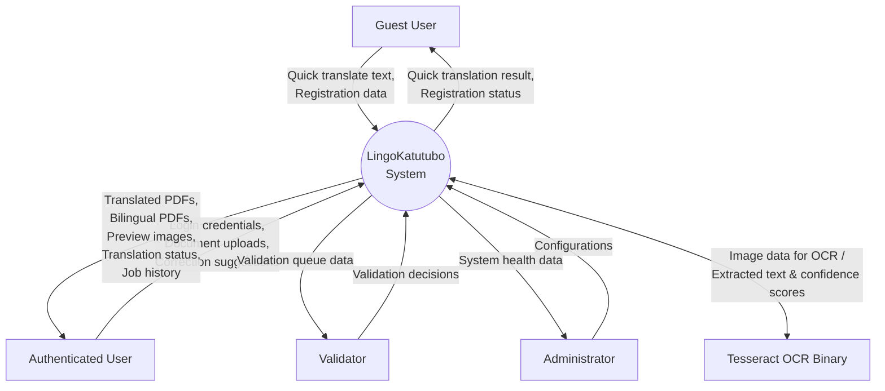
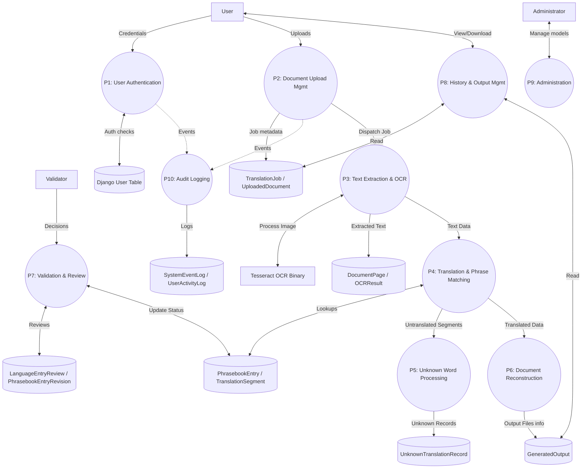
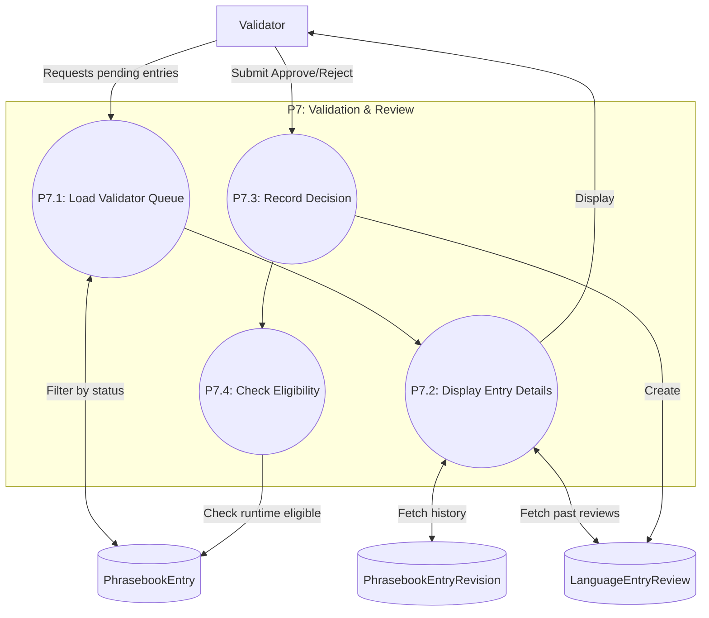

# LingoKatutubo System Data Flow Diagrams

This document contains Data Flow Diagrams (DFDs) modeling the data pathways, processes, external entities, and data stores within the LingoKatutubo system.

## DFD Level 0: Context Diagram

This level shows the system as a single process interacting with its external environment.



## DFD Level 1: Major Processes

This diagram expands the system into its primary functional processes.



## DFD Level 2: Document Processing Pipeline

This diagram breaks down the core translation pipeline processes (`P2`, `P3`, `P4`, `P5`, `P6`).

```mermaid
flowchart TD
    %% External
    Tesseract[Tesseract OCR Binary]
    FileSystem[(MEDIA_ROOT /jobs/{id}/)]

    %% Data Stores
    DS_Job[(TranslationJob)]
    DS_UpDoc[(UploadedDocument)]
    DS_DocPage[(DocumentPage)]
    DS_OCR[(OCRResult)]
    DS_Phrase[(PhrasebookEntry / translation_data.json)]
    DS_Segment[(TranslationSegment)]
    DS_Unknown[(UnknownTranslationRecord)]
    DS_Output[(GeneratedOutput)]

    %% Processes
    subgraph P2 [P2: Document Upload Management]
        P2.1((P2.1: Receive Upload\nValidate form/file))
        P2.2((P2.2: Start Background Job))
    end

    subgraph P3 [P3: Text Extraction & OCR]
        P3.1((P3.1: Detect Document Type))
        P3.2((P3.2: Extract Digital Text))
        P3.3((P3.3: Extract OCR Text))
        P3.4((P3.4: Create Records))
    end

    subgraph P4 [P4: Translation & Phrase Matching]
        P4.1((P4.1: Rebuild Sentences))
        P4.2((P4.2: Phrasebook Cascade Lookup))
        P4.3((P4.3: Neural Fallback))
        P4.4((P4.4: Create TranslationSegment))
    end

    subgraph P5 [P5: Unknown Word Processing]
        P5.1((P5.1: Identify Unknown Segments))
    end

    subgraph P6 [P6: Document Reconstruction]
        P6.1((P6.1: Redact Original Text))
        P6.2((P6.2: Draw Translated Text))
        P6.3((P6.3: Generate Preview PNGs))
        P6.4((P6.4: Generate Bilingual PDF))
        P6.5((P6.5: Create GeneratedOutput))
    end

    %% Flows
    User_Input[/Document Upload/] --> P2.1
    P2.1 -->|Save to disk| FileSystem
    P2.1 -->|Write| DS_Job
    P2.1 -->|Write| DS_UpDoc
    P2.1 -->|Trigger| P2.2
    
    P2.2 -->|Dispatch| P3.1
    P3.1 --> P3.2
    P3.1 --> P3.3
    P3.3 <-->|Image / Confidence scores| Tesseract
    P3.2 --> P3.4
    P3.3 --> P3.4
    P3.4 -->|Write| DS_DocPage
    P3.4 -->|Write| DS_OCR
    
    P3.4 -->|Pass Extracted text| P4.1
    P4.1 --> P4.2
    P4.2 <-->|Read Exact/Normalized/Fuzzy| DS_Phrase
    P4.2 --> P4.3
    P4.3 --> P4.4
    P4.4 -->|Write| DS_Segment
    
    P4.4 --> P5.1
    P5.1 -->|Write untranslatable| DS_Unknown
    
    P4.4 --> P6.1
    P6.1 --> P6.2
    P6.2 --> P6.3
    P6.2 --> P6.4
    P6.3 -->|Render PNGs| FileSystem
    P6.4 -->|Alternating pages| FileSystem
    P6.4 --> P6.5
    P6.3 --> P6.5
    P6.5 -->|Write| DS_Output
```

## DFD Level 2: Validation & Review

This diagram details the `P7` process for handling terminology validation.



## Data Flow Dictionary

| Data Flow | Source | Destination | Contents | Validation | Storage | Evidence |
|---|---|---|---|---|---|---|
| **Document Upload** | External Entity (User) | P2.1 | File binaries, target language, user info | File extension, MIME type, size limit, authentication | Local FileSystem | `EV-001`, `EV-008` |
| **Dispatch Job** | P2.2 | P3.1 | TranslationJob ID | Ensure Job state is PENDING | Queue/DB (`TranslationJob`) | `EV-002` |
| **Extracted Text & BBoxes** | P3.4 | P4.1, `DS_DocPage`, `DS_OCR` | Geometric bboxes, text content, OCR confidence | Coordinate validation, string encoding | DB (`DocumentPage`, `OCRResult`) | `EV-003`, `EV-004` |
| **Match Candidates** | `DS_Phrase` | P4.2 | Phrasebook definitions, target terms | Dataset schema match | DB / JSON | `EV-006` |
| **Translation Output** | P4.4 | P6.1, `DS_Segment` | Original segment, translated segment, bounding box mapping | String mapping integrity | DB (`TranslationSegment`) | `EV-008` |
| **Unknown Segment** | P5.1 | `DS_Unknown` | Untranslatable word/phrase text, language pair | Context constraints | DB (`UnknownTranslationRecord`) | `EV-008` |
| **Rendered Files** | P6.3, P6.4 | `DS_Output`, FileSystem | Reconstructed PDF files, preview PNGs | Output success validation, path existence | FileSystem / DB (`GeneratedOutput`) | `EV-005` |
| **Review Decision** | External Entity (Validator) | P7.3 | Approve/Reject status, optional feedback | Role authorization, valid entry ID | DB (`LanguageEntryReview`) | `EV-007` |

## Evidence Reference

*   **`EV-001`**: `views.py` - Manages incoming requests, document uploads, and authentication.
*   **`EV-002`**: `pipeline_service.py` - Orchestrates the background dispatch and sequential execution of P3-P6.
*   **`EV-003`**: `extraction_service.py` - Handles digital document processing and routing.
*   **`EV-004`**: `ocr_service.py` - Manages interaction with Tesseract and structuring OCR results.
*   **`EV-005`**: `reconstruction_service.py` - Handles redacting, drawing text, and outputting new files.
*   **`EV-006`**: `translation_dataset.py` - Loads and filters phrasebook matching data.
*   **`EV-007`**: `governance.py` - Business logic for reviews, decisions, and runtime eligibility.
*   **`EV-008`**: `models.py` - Core schema definitions for all database tables used in the flows.
