# Entity Relationship Diagram (ERD) Audit Report

## 1. Entity Relationship Diagram

```mermaid
erDiagram
    User ||--o{ TranslationJob : "owns"
    User ||--o{ UploadedDocument : "owns"
    User ||--o{ OCRResult : "reviews"
    User ||--o{ OCRCorrection : "authors"
    User ||--o{ PhrasebookEntry : "validates"
    User ||--o{ PhrasebookEntryRevision : "validates"
    User ||--o{ LanguageResourceImportBatch : "imports"
    User ||--o{ LanguageEntryReview : "reviews"
    User ||--o{ CorrectionSuggestion : "submits / reviews"
    User ||--o{ DatasetImportBatch : "uploads"
    User ||--o{ SystemEventLog : "acts in"
    User ||--o{ UserActivityLog : "performs"

    Language ||--o{ LanguagePair : "source_pairs"
    Language ||--o{ LanguagePair : "target_pairs"

    TranslationJob ||--|| UploadedDocument : "job (OneToOne)"
    TranslationJob ||--o{ DocumentPage : "has"
    TranslationJob ||--o{ OCRResult : "has"
    TranslationJob ||--o{ TranslationSegment : "has"
    TranslationJob ||--o{ UnknownTranslationRecord : "has"
    TranslationJob ||--o{ CorrectionSuggestion : "has"
    TranslationJob ||--o{ GeneratedOutput : "has"
    TranslationJob ||--o{ SystemEventLog : "associated with"

    DocumentPage ||--o{ OCRResult : "page"
    DocumentPage ||--o{ TranslationSegment : "page"
    DocumentPage ||--o{ UnknownTranslationRecord : "page"
    DocumentPage ||--o{ OCRCorrection : "page"

    TranslationSegment ||--|| UnknownTranslationRecord : "segment (OneToOne)"
    TranslationSegment ||--o{ CorrectionSuggestion : "segment"

    OCRResult ||--o{ OCRCorrection : "ocr_result"

    PhrasebookEntry ||--o{ PhrasebookEntryRevision : "revisions"
    PhrasebookEntry ||--o{ LanguageResourceIssue : "issues"
    PhrasebookEntry ||--o{ LanguageEntryReview : "reviews"
    PhrasebookEntry }|--o| LanguageResourceImportBatch : "import_batch"

    LanguageResourceImportBatch ||--o{ LanguageResourceIssue : "batch"

    LanguagePair ||--o{ GlossaryTerm : "language_pair"

    %% Entities
    User {
        int id PK
        string username
    }
    Language {
        int id PK
        string code
        string name
    }
    LanguagePair {
        int id PK
        int source_language_id FK
        int target_language_id FK
    }
    TranslationJob {
        uuid id PK
        int owner_id FK
        string status
    }
    UploadedDocument {
        int id PK
        uuid job_id FK "OneToOne"
    }
    DocumentPage {
        int id PK
        uuid job_id FK
        int page_number
    }
    OCRResult {
        int id PK
        uuid job_id FK
        int page_id FK
    }
    TranslationSegment {
        int id PK
        uuid job_id FK
        int page_id FK
    }
    UnknownTranslationRecord {
        int id PK
        uuid job_id FK
        int segment_id FK "OneToOne"
    }
    OCRCorrection {
        int id PK
        int ocr_result_id FK
    }
    PhrasebookEntry {
        int id PK
        string topic
        int import_batch_id FK
    }
    PhrasebookEntryRevision {
        int id PK
        int entry_id FK
    }
    LanguageResourceImportBatch {
        int id PK
        string identifier
    }
    LanguageResourceIssue {
        int id PK
        int batch_id FK
        int entry_id FK
    }
    LanguageEntryReview {
        int id PK
        int entry_id FK
    }
    CorrectionSuggestion {
        int id PK
        uuid job_id FK
    }
    GlossaryTerm {
        int id PK
        int language_pair_id FK
    }
    GeneratedOutput {
        int id PK
        uuid job_id FK
    }
    DatasetImportBatch {
        int id PK
        int uploaded_by_id FK
    }
    SystemEventLog {
        int id PK
        uuid job_id FK
    }
    UserActivityLog {
        int id PK
        int user_id FK
    }
```

## 2. ERD Explanation Table

| Entity | Purpose | Primary Key | Important Fields | Relationships | Evidence |
| :--- | :--- | :--- | :--- | :--- | :--- |
| `Language` | Stores supported languages | `id` (auto) | `code`, `name`, `is_active` | `source_pairs`, `target_pairs` | EV-DB-001 |
| `LanguagePair` | Maps valid translation directions | `id` (auto) | `is_active`, `notes` | FK to `Language` (source/target) | EV-DB-002 |
| `TranslationJob` | Core model tracking the lifecycle of a translation request | `id` (UUID) | `status`, `progress`, `source_language`, `target_language` | FK to `User`, OneToOne to `UploadedDocument`, FK from multiple job components | EV-DB-003 |
| `UploadedDocument` | Stores initial uploaded file details | `id` (auto) | `original_filename`, `file_type`, `file_path` | FK to `User`, OneToOne to `TranslationJob` | EV-DB-004 |
| `DocumentPage` | Represents a single page within a job | `id` (auto) | `page_number`, `extracted_text` | FK to `TranslationJob` | EV-DB-005 |
| `OCRResult` | Stores raw text extracted via OCR | `id` (auto) | `engine`, `text`, `confidence`, `status` | FK to `TranslationJob`, `DocumentPage`, `User` (reviewer) | EV-DB-006 |
| `TranslationSegment` | A specific text block and its translation | `id` (auto) | `segment_index`, `source_text`, `translated_text` | FK to `TranslationJob`, `DocumentPage` | EV-DB-007 |
| `UnknownTranslationRecord` | Tracks segments that could not be confidently translated | `id` (auto) | `source_text`, `review_status` | FK to `TranslationJob`, `DocumentPage`, OneToOne to `TranslationSegment` | EV-DB-008 |
| `OCRCorrection` | Tracks user-proposed corrections to OCR text | `id` (auto) | `original_ocr_text`, `corrected_text`, `status` | FK to `OCRResult`, `DocumentPage`, `User` | EV-DB-009 |
| `PhrasebookEntry` | Dictionary / Phrasebook terms | `id` (auto) | `topic`, `english`, `tagabawa`, `is_sme_verified` | FK to `User` (validator), `LanguageResourceImportBatch` | EV-DB-010 |
| `PhrasebookEntryRevision` | Audit trail for phrasebook modifications | `id` (auto) | `revision_number`, `snapshot` | FK to `PhrasebookEntry`, `User` (validator) | EV-DB-011 |
| `LanguageResourceImportBatch` | Tracks batch imports of language data | `id` (auto) | `identifier`, `status_counts`, `is_dry_run` | FK to `User` | EV-DB-012 |
| `LanguageResourceIssue` | Logs conflicts or issues during import | `id` (auto) | `category`, `is_resolved` | FK to `LanguageResourceImportBatch`, `PhrasebookEntry` | EV-DB-013 |
| `LanguageEntryReview` | Formal reviews of phrasebook entries | `id` (auto) | `decision`, `notes` | FK to `PhrasebookEntry`, `User` | EV-DB-014 |
| `CorrectionSuggestion` | User feedback on translation output | `id` (auto) | `suggested_correction`, `status` | FK to `TranslationJob`, `TranslationSegment`, `User` | EV-DB-015 |
| `GlossaryTerm` | Custom domain glossaries | `id` (auto) | `source_term`, `target_term`, `domain` | FK to `LanguagePair` | EV-DB-016 |
| `GeneratedOutput` | Final generated files (e.g. PDF) | `id` (auto) | `output_type`, `file_format`, `file_path` | FK to `TranslationJob` | EV-DB-017 |
| `DatasetImportBatch` | General dataset imports | `id` (auto) | `status`, `rows_total` | FK to `User` | EV-DB-018 |
| `SystemEventLog` | System-level audit events | `id` (auto) | `level`, `event_type`, `message` | FK to `User`, `TranslationJob` | EV-DB-019 |
| `UserActivityLog` | User action tracking | `id` (auto) | `action`, `object_type`, `object_id` | FK to `User` | EV-DB-020 |

## 3. Analysis and Recommendations

### Orphaned Models
* **`GlossaryTerm` (EV-DB-016):** Appears to be disconnected from the main translation pipeline. It has a relationship to `LanguagePair`, but is not linked to `TranslationJob` or `TranslationSegment`. Without a linkage to the core processing models, glossary application may be occurring only in-memory or might be completely unimplemented.

### Weakly Enforced Relationships
* **Language Handling in `TranslationJob`:** The `TranslationJob` stores `source_language` and `target_language` as `CharField` (defaults "auto" and "tagabawa") instead of foreign keys to the `Language` model. This bypasses referential integrity and makes it difficult to enforce constraints or cascade updates (EV-DB-003).
* **Polymorphic Logging:** `UserActivityLog` uses `object_type` and `object_id` as standard `CharField`s instead of Generic Foreign Keys (GFKs). This prevents database-level referential integrity and could lead to dangling references if objects are deleted (EV-DB-020).

### Missing Ownership and Auditing
* **`Language` & `LanguagePair`:** Neither model has an `owner`, `created_by`, or `updated_by` field tracking who manages system languages. (EV-DB-001, EV-DB-002)

### Legacy Fields / Normalization Concerns
* **File Paths in `TranslationJob`:** `TranslationJob` contains numerous path fields (`upload_file_path`, `input_file_path`, `output_file_path`, `bilingual_file_path`, `structure_file_path`). This overlaps with the purpose of `UploadedDocument` and `GeneratedOutput`, violating 1NF/2NF. Output files should strictly reside in `GeneratedOutput` (EV-DB-003, EV-DB-017).
* **Metadata Duplication:** JSON `metadata` fields exist on `TranslationJob`, `UploadedDocument`, `DocumentPage`, `TranslationSegment`, `GeneratedOutput`, etc. Care should be taken to ensure overlapping concerns (like document format metadata) are not duplicated across these entities.

## Evidence Reference
* Source File: `translator/models.py` (lines 1-676)
