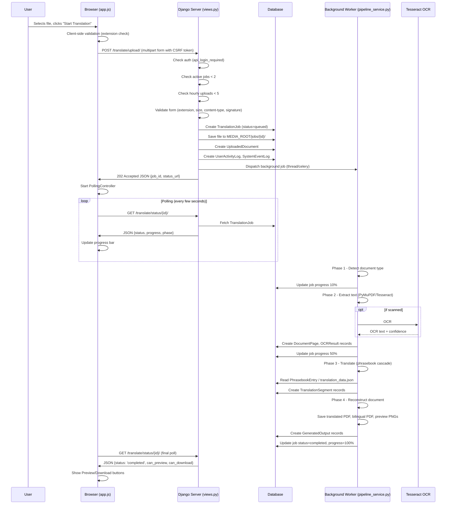
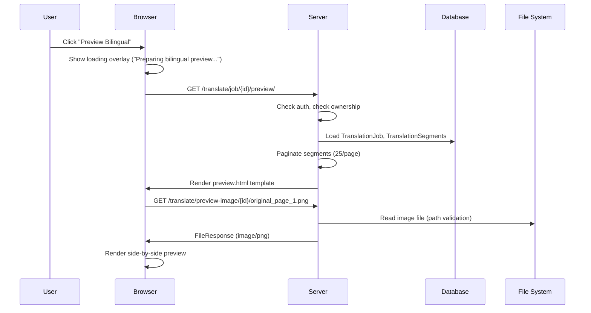
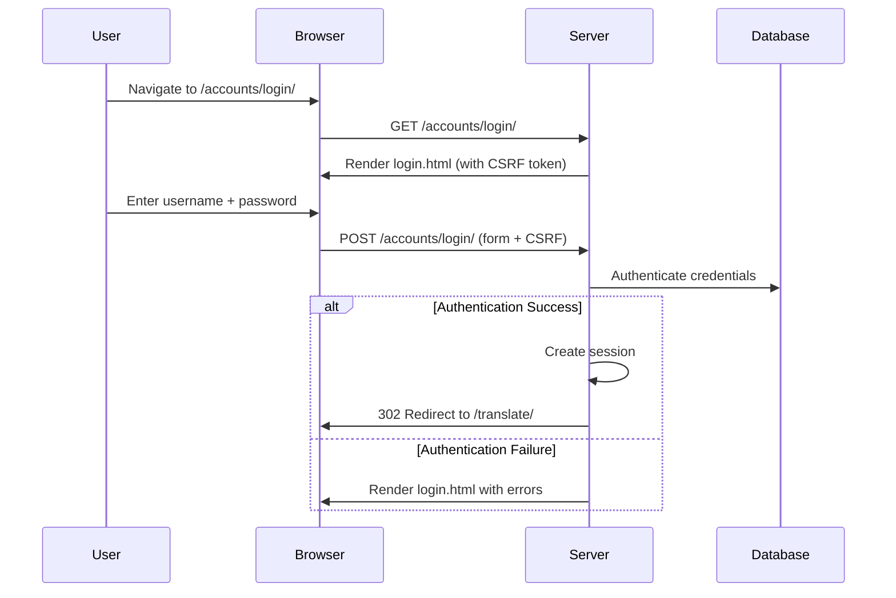
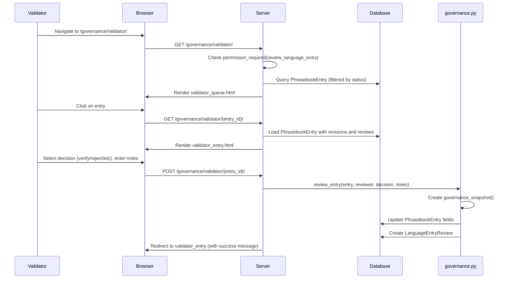
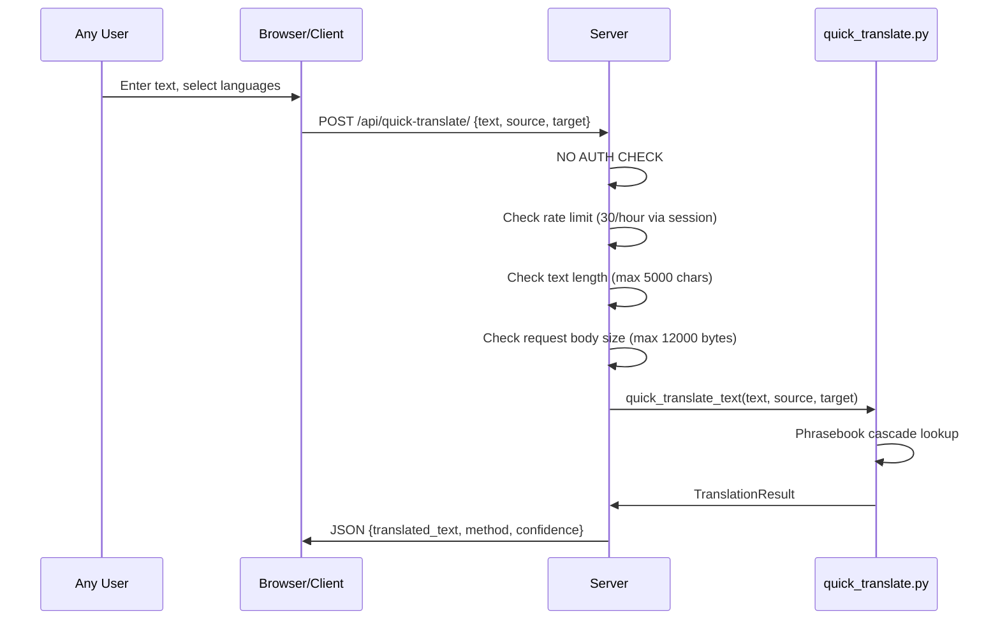
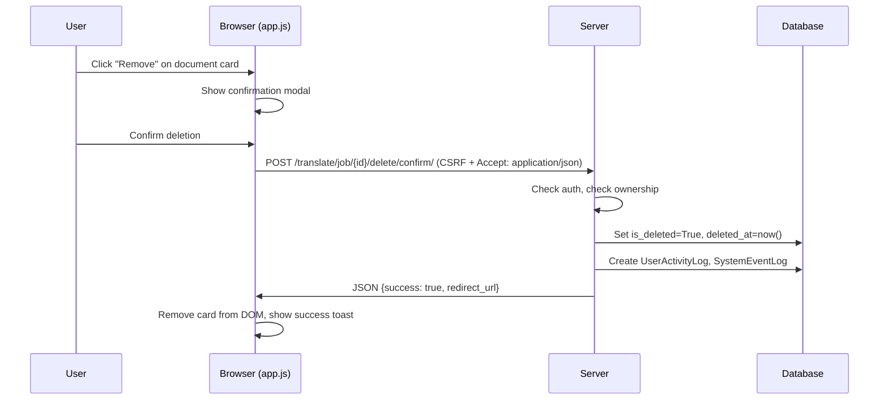
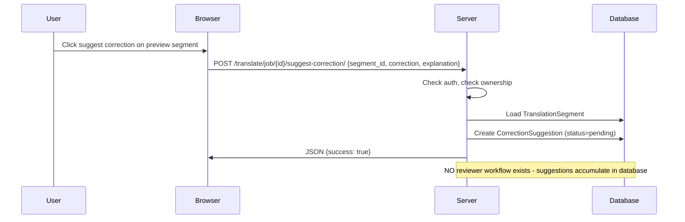

# System Sequence Diagrams

This document outlines the critical interactions in the LingoKatutubo system through sequence diagrams.

## SD-01: Document Upload and Processing

- **Participants**: User, Browser (app.js), Django Server (views.py), Background Worker (pipeline_service.py), Tesseract OCR, Database
- **Trigger**: User selects a file and clicks "Start Translation"
- **Preconditions**: User is logged in. System is accepting jobs.
- **Error Paths**: Invalid file extension/size, API auth failure, active jobs >= 2 limit reached, hourly uploads >= 5 limit reached, OCR failure.
- **Evidence**: EV-001 (views.py), EV-002 (pipeline_service.py)

---

## SD-02: Bilingual Preview Loading

- **Participants**: User, Browser, Server, File System
- **Trigger**: User clicks "Preview Bilingual"
- **Preconditions**: TranslationJob is completed, and user owns the job.
- **Error Paths**: Job not found, not authorized, image file missing on disk.
- **Evidence**: EV-003 (views.py), EV-004 (preview.html)

---

## SD-03: User Login

- **Participants**: User, Browser, Server, Database
- **Trigger**: User navigates to /accounts/login/ and submits credentials
- **Preconditions**: None
- **Error Paths**: Invalid credentials, account disabled.
- **Evidence**: EV-005 (accounts/views.py)

---

## SD-04: Validator Reviews Entry

- **Participants**: Validator, Browser, Server, Database, governance.py
- **Trigger**: Validator clicks on an entry in the review queue and submits a review decision
- **Preconditions**: User has `review_language_entry` permission.
- **Error Paths**: Permission denied, entry not found.
- **Evidence**: EV-006 (governance.py), EV-007 (views.py)

---

## SD-05: Quick Translate (No Auth)

- **Participants**: Any User, Browser/Client, Server, quick_translate.py
- **Trigger**: User enters text and selects languages to translate using the Quick Translate feature
- **Preconditions**: Text length < 5000 chars, request body < 12000 bytes
- **Error Paths**: Rate limit exceeded (30/hour), text too long, request too large.
- **Evidence**: EV-008 (quick_translate.py)

---

## SD-06: Job Deletion (AJAX)

- **Participants**: User, Browser (app.js), Server, Database
- **Trigger**: User clicks "Remove" on a job and confirms
- **Preconditions**: Job belongs to user.
- **Error Paths**: Unauthorized, job not found.
- **Evidence**: EV-009 (views.py), EV-010 (app.js)

---

## SD-07: Correction Suggestion

- **Participants**: User, Browser, Server, Database
- **Trigger**: User submits a correction suggestion on a preview segment
- **Preconditions**: Job belongs to user, TranslationSegment exists
- **Error Paths**: Unauthorized, segment not found
- **Evidence**: EV-011 (views.py)
