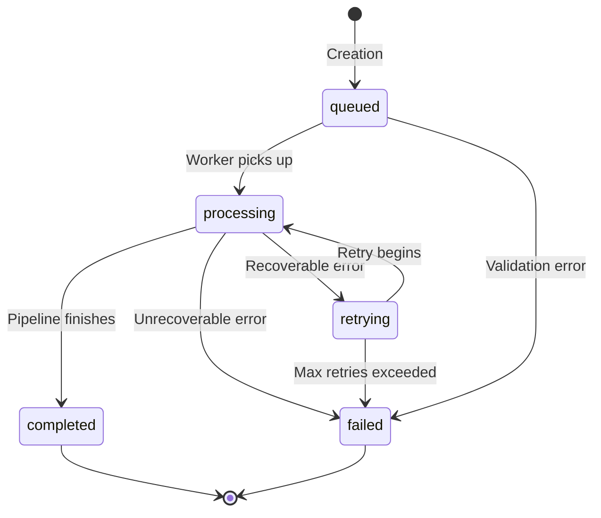
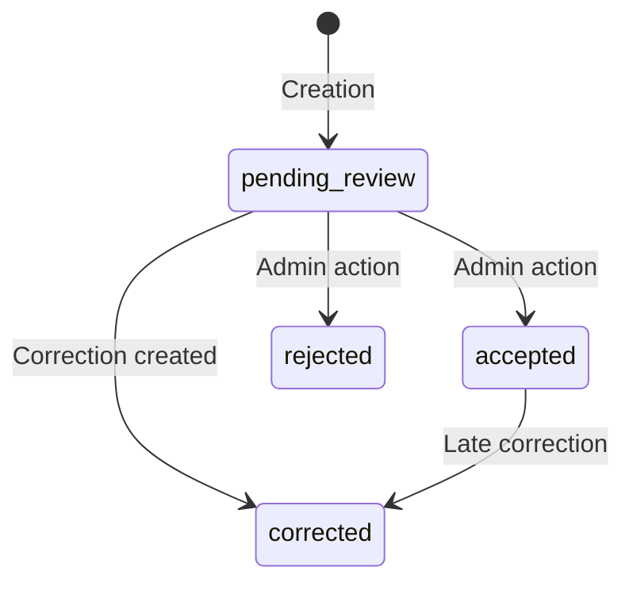
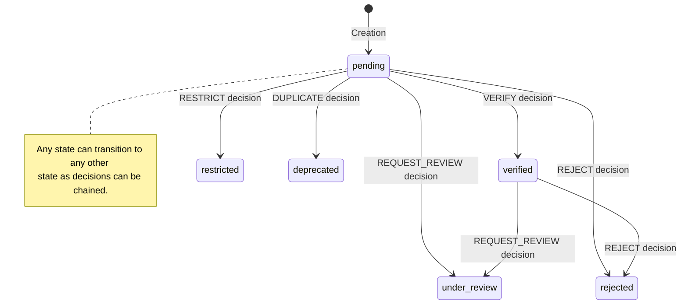
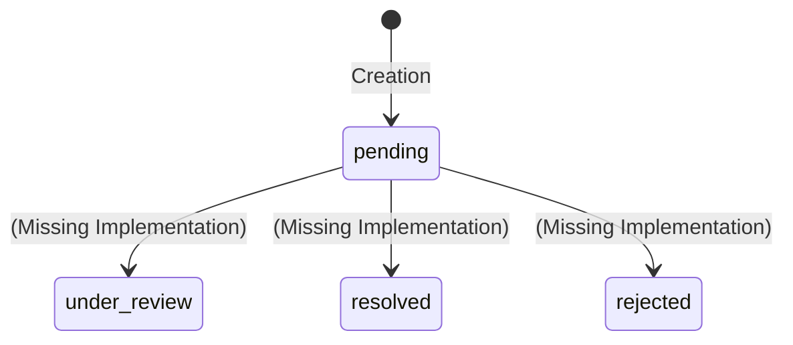
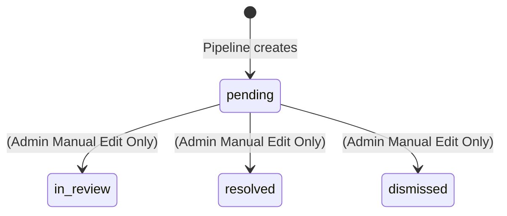
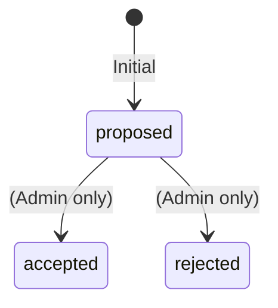
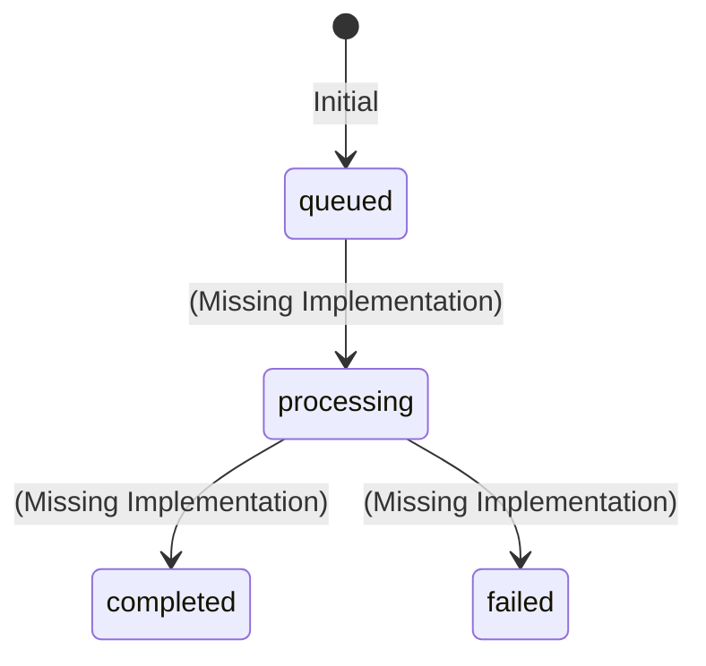

# State Machine Audit: LingoKatutubo System

This document provides a comprehensive audit of all stateful entities within the LingoKatutubo system, detailing their state machines, transition triggers, and associated side effects.

## Evidence Reference

- **EV-SM-001**: `models.py:73-78` (TranslationJob Status choices)
- **EV-SM-002**: `pipeline_service.py` (TranslationJob phase transitions)
- **EV-SM-003**: `models.py:190-200` (OCRResult.Status choices)
- **EV-SM-004**: `admin.py:275-281` (OCRResult admin actions)
- **EV-SM-005**: `governance.py:17-84` (PhrasebookEntry transitions and eligibility)
- **EV-SM-006**: `models.py:341-413` (PhrasebookEntry model)
- **EV-SM-007**: `models.py:499-515` (CorrectionSuggestion.status choices)
- **EV-SM-008**: `views.py:791-805` (CorrectionSuggestion view)
- **EV-SM-009**: `models.py:289-315` (UnknownTranslationRecord model)
- **EV-SM-010**: `admin.py:292-297` (UnknownTranslationRecord admin)
- **EV-SM-011**: `models.py:318-338` (OCRCorrection model)
- **EV-SM-012**: `admin.py:284-289` (OCRCorrection admin)
- **EV-SM-013**: `models.py:588-615` (DatasetImportBatch model)
- **EV-SM-014**: `models.py:478-496` (LanguageEntryReview model)

---

## SM-01: `TranslationJob.status`

Tracks the lifecycle of a translation job as it progresses through the pipeline.

### State Diagram

### Transition Table

| Current State | Trigger/Event | Next State | Side Effects | Evidence |
|---------------|---------------|------------|--------------|----------|
| `None` | Creation | `queued` | Progress set to 0% | EV-SM-001, EV-SM-002 |
| `queued` | Worker picks up job | `processing` | Progress tracking begins | EV-SM-002 |
| `queued` | Validation error before processing | `failed` | - | EV-SM-002 |
| `processing` | All pipeline phases complete | `completed` | Progress set to 100% | EV-SM-002 |
| `processing` | Unrecoverable error | `failed` | - | EV-SM-002 |
| `processing` | Recoverable error | `retrying` | - | EV-SM-002 |
| `retrying` | Retry attempt begins | `processing` | - | EV-SM-002 |
| `retrying` | Max retries exceeded | `failed` | - | EV-SM-002 |

> [!NOTE] 
> **Progress Tracking:**
> Progress values are: queued (0%), detecting (~10%), extracting (~25%), translating (~50%), reconstructing (~70%), previewing (~85%), completed (100%).
> **Soft Delete (Orthogonal):** 
> Any state with `is_deleted=False` can transition to `is_deleted=True` by user action. This affects visibility only and does not change the pipeline status.

---

## SM-02: `OCRResult.status`

Tracks the validation and correction states of Optical Character Recognition outputs.

### State Diagram

### Transition Table

| Current State | Trigger/Event | Next State | Side Effects | Evidence |
|---------------|---------------|------------|--------------|----------|
| `None` | Creation | `pending_review` | - | EV-SM-003 |
| `pending_review`| Admin approval | `accepted` | - | EV-SM-004 |
| `pending_review`| OCRCorrection created | `corrected` | - | EV-SM-004 |
| `pending_review`| Admin rejection | `rejected` | - | EV-SM-004 |
| `accepted` | OCRCorrection created later | `corrected` | - | EV-SM-004 |

---

## SM-03: `PhrasebookEntry.validation_status`

Manages the community review and governance lifecycle of phrasebook entries.

### State Diagram

### Transition Table

| Current State | Trigger/Event | Next State | Side Effects | Evidence |
|---------------|---------------|------------|--------------|----------|
| `None` | Creation | `pending` | - | EV-SM-005, EV-SM-006 |
| `pending` | `VERIFY` decision | `verified` | `needs_review=False`, `validator=reviewer`, `validation_date=now` | EV-SM-005 |
| `pending` | `REJECT` decision | `rejected` | `is_approved_for_runtime=False` | EV-SM-005 |
| `pending` | `RESTRICT` decision | `restricted` | `access_restriction='restricted'`, `is_approved_for_runtime=False` | EV-SM-005 |
| `pending` | `DUPLICATE` decision| `deprecated`| `is_active=False`, `is_approved_for_runtime=False` | EV-SM-005 |
| `pending` | `REQUEST_REVIEW` | `under_review`| `needs_review=True` | EV-SM-005 |
| `verified`| `REQUEST_REVIEW` | `under_review`| `needs_review=True` | EV-SM-005 |
| `verified`| `REJECT` decision | `rejected` | `is_approved_for_runtime=False` | EV-SM-005 |
| *Any* | *Any decision* | *Any* | New review overrides previous status | EV-SM-005 |

> [!IMPORTANT]
> **Runtime Eligibility Requirements:**
> For an entry to be eligible at runtime, it must satisfy: `is_active=True`, `validation_status='verified'`, `is_approved_for_runtime=True`, `license_status` in {permitted, public_domain, cc-by, cc-by-sa}, `access_restriction='public'`, `cultural_sensitivity_status` in {approved, not_sensitive}, `has_unresolved_conflict=False`, `source_title` AND `source_owner` must be non-empty, and verified reviews count >= `required_reviews`.

---

## SM-04: `CorrectionSuggestion.status`

Tracks community suggestions for corrections.

### State Diagram

### Transition Table

| Current State | Trigger/Event | Next State | Side Effects | Evidence |
|---------------|---------------|------------|--------------|----------|
| `None` | Creation | `pending` | - | EV-SM-007, EV-SM-008 |
| `pending` | *No transition exists* | `under_review` | - | EV-SM-008 |
| `pending` | *No transition exists* | `resolved` | - | EV-SM-008 |
| `pending` | *No transition exists* | `rejected` | - | EV-SM-008 |

---

## SM-05: `UnknownTranslationRecord.review_status`

Tracks unknown translation records flagged during processing.

### State Diagram

### Transition Table

| Current State | Trigger/Event | Next State | Side Effects | Evidence |
|---------------|---------------|------------|--------------|----------|
| `None` | Pipeline identifies record | `pending` | - | EV-SM-009, EV-SM-010 |
| `pending` | *Admin edit* | `in_review` | - | EV-SM-010 |
| `pending` | *Admin edit* | `resolved` | - | EV-SM-010 |
| `pending` | *Admin edit* | `dismissed`| - | EV-SM-010 |

---

## SM-06: `OCRCorrection.status`

Tracks manual OCR corrections.

### State Diagram

### Transition Table

| Current State | Trigger/Event | Next State | Side Effects | Evidence |
|---------------|---------------|------------|--------------|----------|
| `None` | Creation | `proposed` | - | EV-SM-011 |
| `proposed`| Admin action | `accepted` | - | EV-SM-012 |
| `proposed`| Admin action | `rejected` | - | EV-SM-012 |

---

## SM-07: `DatasetImportBatch.status`

Tracks bulk dataset import jobs.

### State Diagram

### Transition Table

| Current State | Trigger/Event | Next State | Side Effects | Evidence |
|---------------|---------------|------------|--------------|----------|
| `None` | Creation | `queued` | - | EV-SM-013 |
| `queued` | *No processing workflow* | `processing` | - | EV-SM-013 |
| `processing` | *No processing workflow* | `completed` | - | EV-SM-013 |
| `processing` | *No processing workflow* | `failed` | - | EV-SM-013 |

---

## SM-08: `LanguageEntryReview.decision`

This represents an append-only log of discrete decisions rather than a state machine, which impacts `PhrasebookEntry` (SM-03).

### Decision Types
- `keep_both`
- `duplicate`
- `verify`
- `reject`
- `restrict`
- `request_review`

Each decision triggers transitions on `PhrasebookEntry` (see SM-03) and creates a new review record. (Evidence: EV-SM-014)

---

## Analysis

### 1. Complete State Machines
- **SM-01 (TranslationJob)**: Well-defined, complete transitions governed by a background worker and pipeline service.
- **SM-03 (PhrasebookEntry)**: Comprehensive governance workflow driven by community decisions. Robust logic dictates runtime eligibility based on these states.

### 2. Incomplete State Machines
- **SM-04 (CorrectionSuggestion)**: The system creates suggestions in the `pending` state, but there is no application code (UI/API) to review, resolve, or reject them.
- **SM-07 (DatasetImportBatch)**: The model has status fields (`queued`, `processing`, `completed`, `failed`), but there is no actual processing workflow to transition the status.

### 3. Missing Transition Mechanisms & Orphaned States
- **CorrectionSuggestion** (`under_review`, `resolved`, `rejected`): These states can never be reached under normal application flow.
- **UnknownTranslationRecord** (`in_review`, `resolved`, `dismissed`): Rely entirely on manual Django Admin intervention instead of a dedicated workflow or API.
- **DatasetImportBatch** (`processing`, `completed`, `failed`): Orphaned states since no job processor exists.

### 4. Admin-Only Workflows
- **SM-02 (OCRResult)** and **SM-06 (OCRCorrection)** transitions heavily rely on Django Admin actions. While functional, they lack a dedicated user-facing workflow, limiting scalability for community-driven correction.
