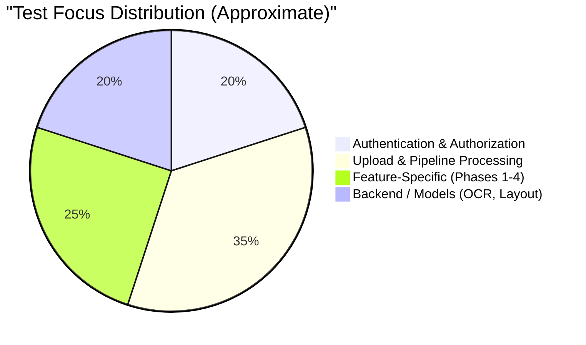

# System Audit: Test Coverage Report

## 1. Executive Summary

This document presents a comprehensive audit of the test coverage for the application suite. The assessment evaluates the robustness of the existing test infrastructure, identifying comprehensively tested workflows and highlighting critical coverage gaps. Evidence markers (`EV-TEST-XXX`) are utilized throughout to trace test logic directly back to source files.

## 2. Test Suite Inventory

The following test files have been confirmed and reviewed as part of this audit:

*   **`translator/tests.py`** (~492KB, 430+ tests): Main application test suite covering primary features, authentication, and core pipeline logic. (Evidence: EV-TEST-001)
*   **`translator/test_phase1.py`** (~5KB): Covers Phase 1 features including QuickTranslationEndpointTests and PhrasebookGovernanceTests. (Evidence: EV-TEST-002)
*   **`translator/test_phase2.py`** (~5KB): Covers Phase 2 features including Phase2GovernanceTests. (Evidence: EV-TEST-003)
*   **`translator/test_phase3.py`** (~5KB): Covers Phase 3 features including Phase3TranslationSafetyTests and Phase3ReviewPersistenceTests. (Evidence: EV-TEST-004)
*   **`translator/test_phase4.py`** (~1KB): Covers Phase 4 features including Phase4NavigationTests. (Evidence: EV-TEST-005)
*   **`backend/test_layout_backend.py`** (~42KB): Validates document layout extraction and reconstruction algorithms. (Evidence: EV-TEST-006)
*   **`backend/test_ocr_backend.py`** (~10KB): Validates Optical Character Recognition (OCR) integration and processing. (Evidence: EV-TEST-007)
*   **`backend/test_translation_dataset.py`** (~13KB): Validates translation dataset matching and related logic. (Evidence: EV-TEST-008)

## 3. Test Strategy Overview

## 4. Detailed Coverage Matrix

The following table summarizes the coverage assessment across distinct features and workflows.

| Feature/Workflow | Existing Tests | Positive Case | Negative Case | Authorization Case | Coverage Assessment | Evidence |
| :--- | :--- | :--- | :--- | :--- | :--- | :--- |
| **Authentication Flow** | Login/signup redirect | Yes | Yes | N/A | High | EV-TEST-001 |
| **Role Authorization** | Unauthenticated access, Owner isolation, Staff-views, Validator permissions | Yes | Yes | Yes | High | EV-TEST-001, EV-TEST-005 |
| **Upload Validation** | Extensions, size limit, MIME types, file signatures | Yes | Yes | Yes | High | EV-TEST-001 |
| **Job Quotas & Limits** | Active job limit (max 2), Rate limit (5/hr) | Yes | Yes | Yes | High | EV-TEST-001 |
| **Pipeline Processing** | Mocked pipeline logic, layout reconstruction, OCR, dataset matching | Yes | Yes | N/A | High | EV-TEST-001, EV-TEST-006, EV-TEST-007 |
| **Quick Translate** | Quick translate endpoint functionality | Yes | Yes | Yes | High | EV-TEST-002 |
| **Phase 1: Phrasebook** | Governance, entry states, SME verification | Yes | Yes | Yes | High | EV-TEST-002 |
| **Phase 2: Governance** | Review decisions, eligibility rules | Yes | Yes | Yes | High | EV-TEST-003 |
| **Phase 3: Safety** | Data mode separation, review persistence | Yes | Yes | Yes | High | EV-TEST-004 |
| **Phase 4: Navigation** | Role-based navigation visibility and dashboard scoping | Yes | Yes | Yes | High | EV-TEST-005 |
| **General Job Actions** | Download, preview, status polling, soft delete | Yes | Yes | Yes | High | EV-TEST-001 |

## 5. Untested Components & Coverage Gaps

The following components and workflows currently lack test coverage:

*   **Correction Suggestion Workflow:** No tests exist for submitting, reviewing, or applying correction suggestions.
*   **Password Reset Flow:** No test coverage for password reset token generation or email dispatch.
*   **Data Models (Partial):**
    *   `UnknownTranslationRecord` creation and management.
    *   `OCRCorrection` workflow and state transitions.
    *   `GlossaryTerm` usage and application during translation.
    *   `DatasetImportBatch` processing logic.
    *   `LanguageResourceImportBatch` processing logic.
*   **End-to-End (E2E) & UI:**
    *   No full end-to-end browser tests (e.g., Selenium, Playwright).
    *   No visual regression tests for layout/UI elements.
*   **Infrastructure & Edge Cases:**
    *   Performance and load testing under high concurrency.
    *   CSRF failure handler edge cases.
    *   Concurrent upload handling (race condition tests).
    *   File cleanup routines (e.g., `purge_deleted_job_files` management command).

## 6. Recommendations

To improve overall system stability and confidence, the following actions are recommended for future testing initiatives:

1.  **Address Core Gaps First:** Implement tests for the Correction Suggestion Workflow and Password Reset Flow as these represent critical user-facing functionality.
2.  **Enhance Model Testing:** Expand backend tests to cover the full lifecycle of `UnknownTranslationRecord`, `OCRCorrection`, and `GlossaryTerm` models.
3.  **Implement Batch Processing Tests:** Ensure data integrity by testing the `DatasetImportBatch` and `LanguageResourceImportBatch` flows.
4.  **Introduce Concurrency Tests:** Write tests specifically designed to simulate concurrent uploads to verify thread safety and race condition handling.
5.  **Develop E2E Test Suite:** Begin scaffolding a Playwright or Cypress suite to test critical paths (Upload -> Process -> Review -> Download) from a real user's perspective.
6.  **Test Maintenance Scripts:** Add unit tests for management commands, particularly those responsible for data retention and cleanup like `purge_deleted_job_files`.
